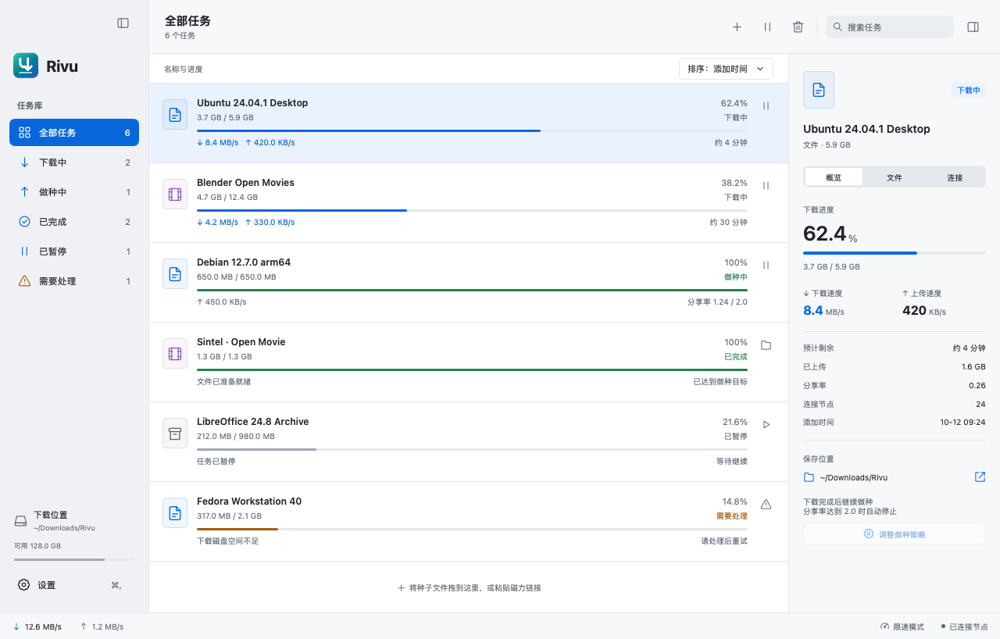
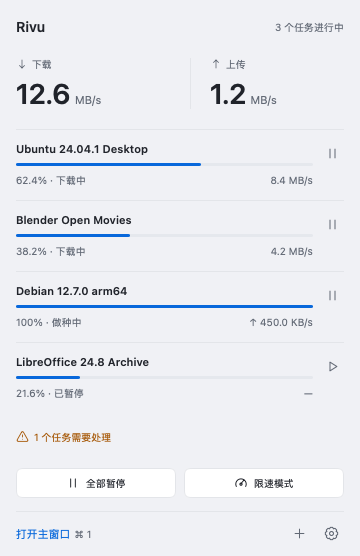
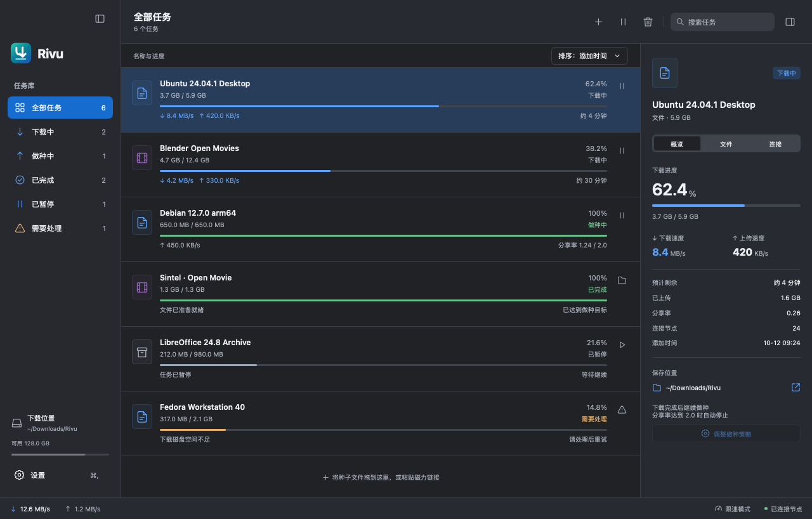

<p align="center">
  
</p>

<h1 align="center">Rivu</h1>

<p align="center"><strong>让下载安静流动。</strong></p>
<p align="center">支持 macOS、Windows 和 Linux 的原生 BitTorrent 应用。选择需要的文件，整理下载队列，让传输在后台继续。</p>

<p align="center">
  <a href="https://rivu.ntnyq.dev/zh/">产品主页</a> ·
  <a href="https://rivu.ntnyq.dev/zh/guide/getting-started.html">开始使用</a> ·
  <a href="https://rivu.ntnyq.dev/zh/guide/">使用文档</a> ·
  <a href="https://github.com/ntnyq/rivu/issues">问题反馈</a>
</p>

<p align="center">
  
  
  
  
</p>

<p align="center"><a href="README.md">English</a> · 简体中文</p>

<picture>
  <source media="(prefers-color-scheme: dark)" srcset="docs/images/main-dark.png">
  
</picture>

## 为什么选择 Rivu？

- **原生跨平台。** 支持 macOS、Windows 和 Linux，提供原生窗口、浅色与深色外观、键盘快捷键和命令面板，使用 Go 与 MyGo 构建。
- **只下载需要的文件。** 添加种子或磁力链接，预览内容，选择文件并设置优先级。支持 v1、v2 和混合种子。
- **让队列井然有序。** 搜索、排序和标记任务，限制带宽与并发下载数；批量暂停后恢复，保留单独暂停的任务。
- **接着上次继续。** 重启后恢复任务，校验已有数据再继续下载；也可复用已有文件或修改任务位置。
- **做种由你决定。** 完成后停止、达到目标分享率后停止，或限制做种时长；也可不限分享率持续做种。
- **省去重复操作。** 按每日时段限速，监视文件夹并自动导入新种子。

移除任务默认保留文件；将下载文件移到废纸篓需要单独选择。

## 关闭窗口，继续下载

传输在后台运行时，Rivu 仍驻留菜单栏或系统托盘。无需重新打开主窗口，就能查看进度、暂停队列、切换限速或添加下载。

<p align="center">
  
</p>

<details>
  <summary>查看深色外观</summary>

  
</details>

<sub>截图由应用界面渲染器生成，使用简体中文界面与演示传输数据。</sub>

## 开始使用

Rivu 支持 **macOS、Windows 和 Linux**，目前正在开发中。从 [GitHub Releases](https://github.com/ntnyq/rivu/releases) 下载对应系统的安装包：

| 系统            | 发布产物                                 | 安装方式                                                         |
| --------------- | ---------------------------------------- | ---------------------------------------------------------------- |
| macOS 12+       | 通用 `.dmg`（Apple Silicon 和 Intel）    | 打开后将 **Rivu.app** 拖入**应用程序**。                         |
| Windows 10 / 11 | x64 `Setup .exe`                         | 运行安装程序。                                                   |
| Linux           | x64 `.deb`，或 `.tar.gz` 与 `install.sh` | 安装 DEB，或将压缩包与脚本下载到同一目录，运行 `sh install.sh`。 |

当前 macOS 下载包尚未使用 Apple Developer ID 签名，也未经过 Apple 公证。首次打开被 macOS 拦截时，请参考[被 macOS 拦截时打开 Rivu](https://rivu.ntnyq.dev/zh/guide/getting-started.html#被-macos-拦截时打开-rivu)。新版发行构建支持从 GitHub Releases 获取签名更新，使用方式见[更新设置](https://rivu.ntnyq.dev/zh/guide/settings.html#更新)。

项目在 `go.mod` 中固定 **MyGo v0.6.3** 及其 CLI 工具，无需单独安装 MyGo。

如果希望从源码构建，在当前系统上安装 Go 1.27.2 或更高版本后运行：

```sh
git clone https://github.com/ntnyq/rivu.git
cd rivu
go mod download
go run .
```

运行 `go tool mygo build` 可打包当前系统的应用；macOS 添加 `-skip-dmg` 可仅生成应用包。首次下载见[快速开始](https://rivu.ntnyq.dev/zh/guide/getting-started.html)，构建细节见[开发指南](https://rivu.ntnyq.dev/zh/development/)。

## 使用你熟悉的语言

**English · 简体中文 · 繁體中文 · 日本語 · 한국어**

Rivu 默认跟随系统语言，也可在 **设置 → 通用 → 语言** 中修改。文档提供[简体中文](https://rivu.ntnyq.dev/zh/)和 [English](https://rivu.ntnyq.dev) 两个版本。

## 文档与反馈

- [使用指南](https://rivu.ntnyq.dev/zh/guide/)：添加下载、管理传输、自动化与设置。
- [故障排查](https://rivu.ntnyq.dev/zh/guide/troubleshooting.html)：磁力链接、连接问题与会话恢复。
- [开发指南](https://rivu.ntnyq.dev/zh/development/)：构建、测试、架构与发布准备。
- [GitHub Issues](https://github.com/ntnyq/rivu/issues)：报告问题或提出建议，请附上操作系统与版本、Rivu 版本与复现步骤。

本地编辑文档可运行 `pnpm install` 和 `pnpm docs:dev`，使用 `pnpm docs:build` 验证构建。修改时请保持中英文页面一致。

## 致谢与许可

Rivu 基于 [MyGo](https://github.com/egoist/mygo) 和 [anacrolix/torrent](https://github.com/anacrolix/torrent) 构建。依赖许可见[第三方声明](THIRD_PARTY_NOTICES.md)。Rivu 自身代码的许可证尚未选定。
