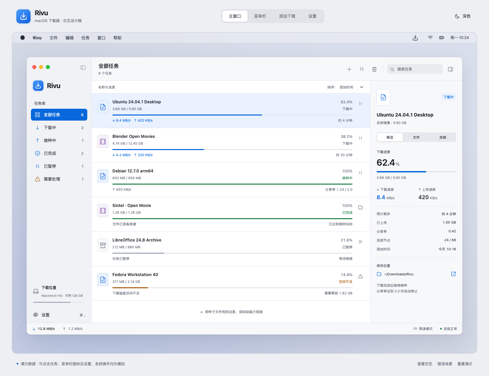
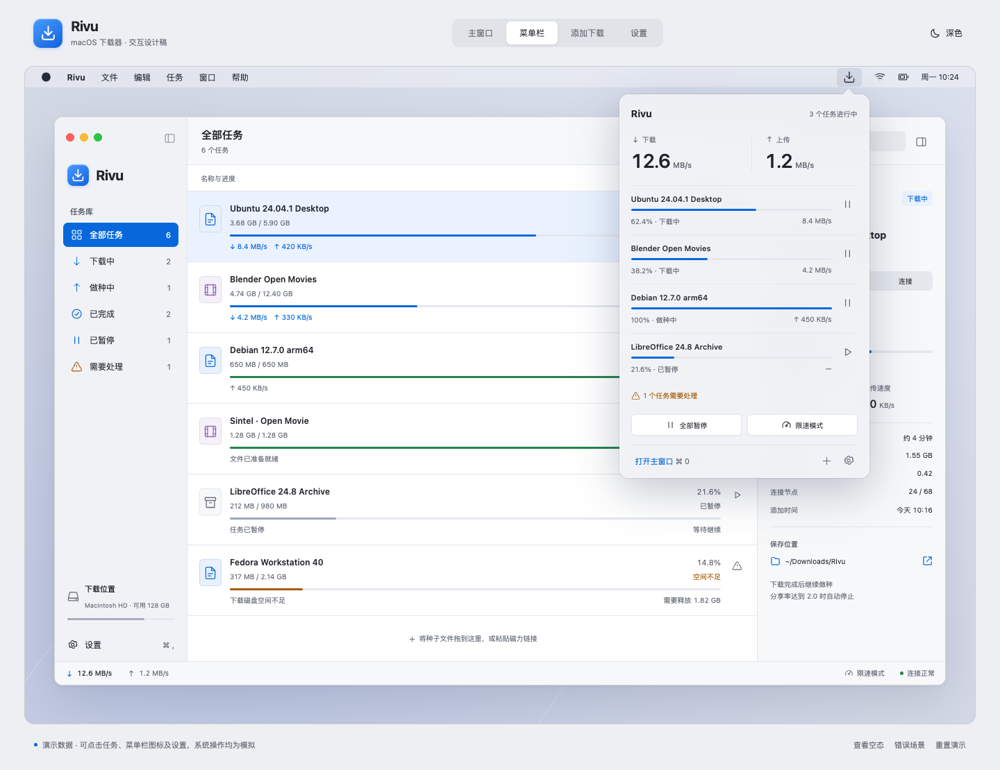
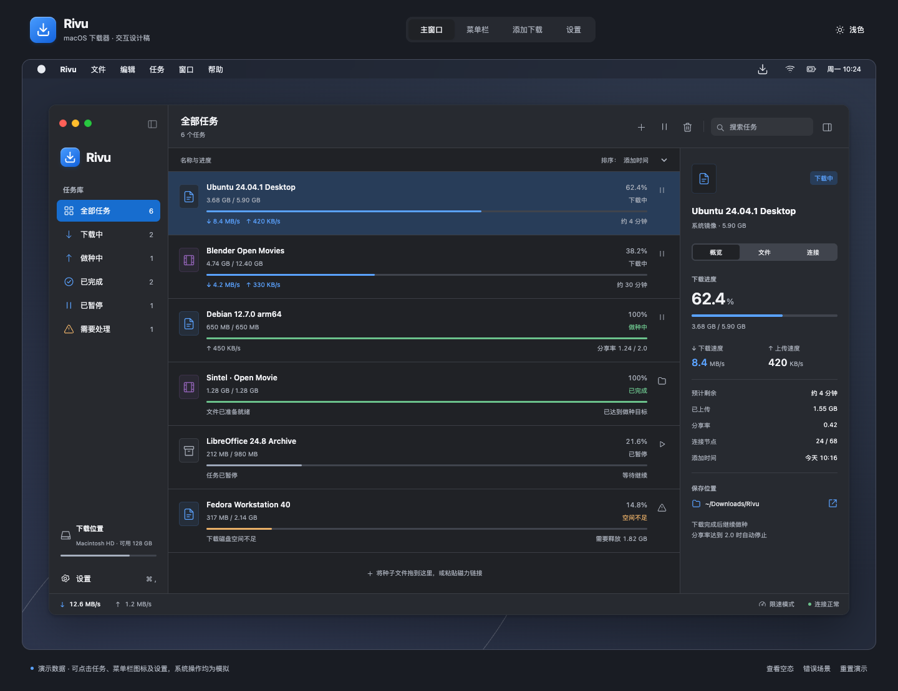
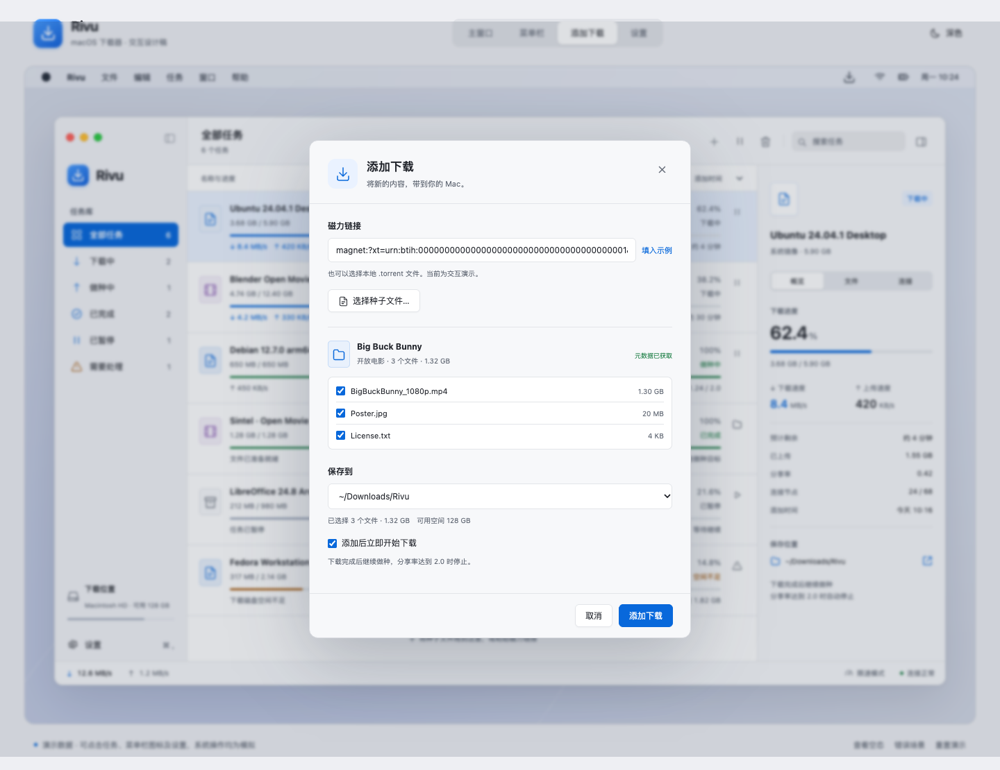
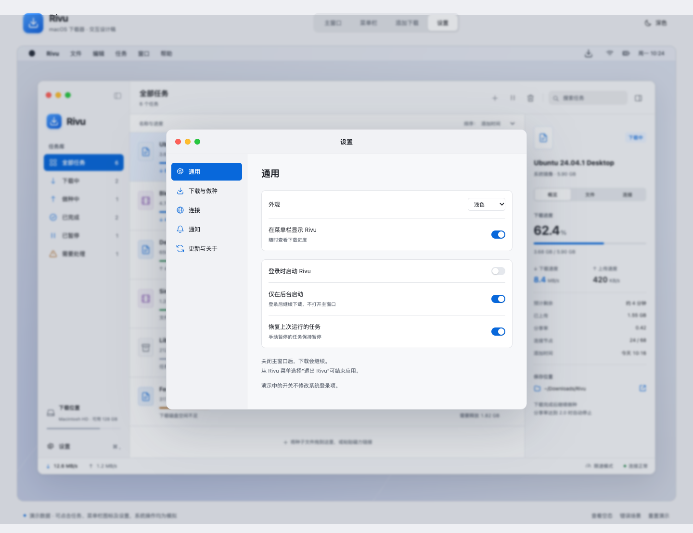
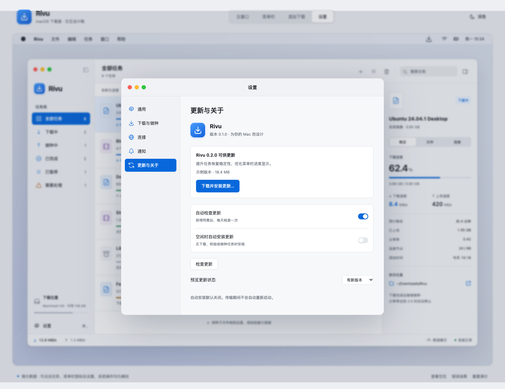
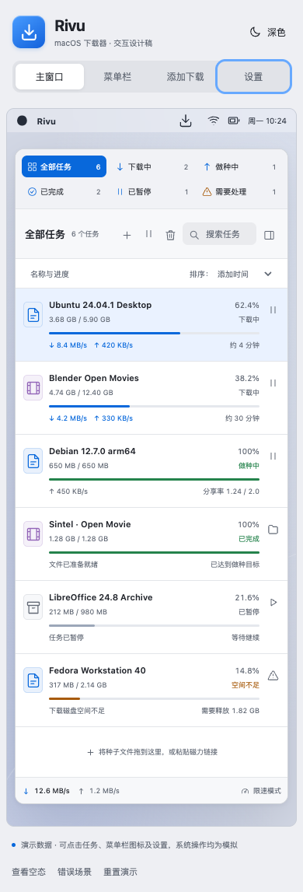

# Rivu Interface Prototype

This review-only prototype accompanies the [Rivu product specification](../history/product-design.md). The application continues to use Go + MyGo native UI. These HTML, CSS, and JavaScript files are not an application frontend migration.

Documentation is in English. Interface copy remains Chinese for this design review.

## Open the prototype

Open `index.html` in a browser; all assets are local and no build or package installation is required. Alternatively, from the repository root:

```sh
python3 -m http.server 8765 --bind 127.0.0.1 --directory docs/design
```

Then open `http://127.0.0.1:8765`.

## Review flows

- Use the top scene controls for the main window, menu bar panel, Add Download sheet, or Settings.
- Filter, search, and sort tasks. Select one to inspect Overview, Files, and Connections.
- Pause/resume tasks and observe synchronized list, total rates, and panel state.
- Pause all running tasks in the panel, then resume that batch. Previously paused tasks stay paused.
- Toggle temporary limits. Close the simulated main window and reopen it from the panel.
- Add the sample torrent, select files, and choose a destination. Add it again to inspect duplicate handling.
- Remove a task with the separate, initially unchecked data-removal option.
- Inspect startup, notification, connection, and update settings. Preview available, unconfigured, and failed update states.
- Switch light/dark appearance. Use footer controls for empty/error states and resetting sample tasks.

## Boundaries

This prototype does not download data, read the clipboard, modify login items, show real system notifications, open Finder, install updates, or delete files. Sample magnets and tracker addresses are fixtures and are not intended to resolve.

The torrent picker simulates selecting a sample. Arbitrary magnets are rejected with an explanation because no metadata retrieval is implemented. Desktop menu labels and yellow/green window dots are presentation elements. Multi-selection, real drag-and-drop import, editable file priorities, and native dialogs are specified but not implemented here.

Settings and tasks live in memory; reloading resets them. Reset restores task fixtures, not every preference. The background-only launch switch becomes enabled when Launch at Login is checked. Preferences demonstrate settings state without changing operating system behavior.

Product layout targets use native points. The browser presentation approximates that design; validate native materials, text sizing, accessibility, and window behavior in MyGo on macOS.

## Files

| File         | Purpose                                          |
| ------------ | ------------------------------------------------ |
| `index.html` | Application shell and dialogs                    |
| `styles.css` | Light/dark appearance and adaptive review layout |
| `app.js`     | In-memory sample state and interactions          |
| `previews/`  | Captured review images                           |

The prototype uses system fonts and locally defined vector symbols. It makes no external resource or application API requests.

## Preview images





<details>
<summary>More prototype screens</summary>











</details>

## Validation

Validated on October 12, 2026:

- JavaScript syntax check passed.
- 29 browser interaction checks passed, covering filtering, search, pause/resume synchronization, batch pause ownership, limits, import validation, duplicates, removal defaults, login settings, update states, window reopening, empty/error states, and theme selection.
- Follow-up checks passed for panel anchoring, scene selection after sheet dismissal, and a 390 px review viewport without horizontal page overflow.
- Browser console contained no errors or warnings after the final reload and interaction checks.
- `go test -race ./...`, `go vet ./...`, and `go tool mygo vet` passed for the existing application.

Native Go application code was not changed. These results do not validate actual torrent transfers, native menu bar panels, login items, notifications, or installation of updates; those remain implementation-stage acceptance work.
