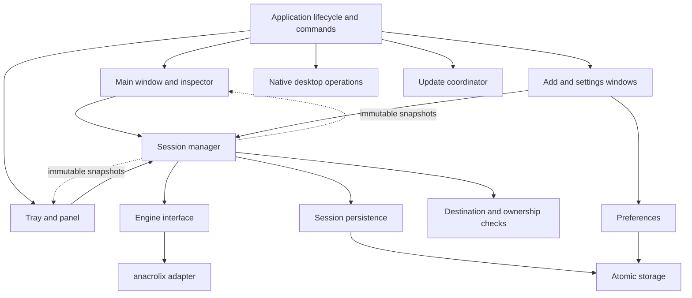

# Rivu Code Implementation Plan

> Historical design reference (October 12, 2026). For the shipped code and current dependency versions, see [architecture](architecture.md), [source structure](implementation-structure.md), and [implementation status](implementation-status.md).


Date: October 12, 2026. Status: implementation design; native transfer features are not implemented by this document.

Implement the [product requirements](product-design.md) and [screen prototype](design/README.md) as a Go and MyGo macOS application. Use [the proposed file structure](implementation-structure.md) as the file ownership guide. Preserve the existing native stack, introduce one application-owned transfer session, and make the main window and menu bar panel projections of that session.

The design baseline comes from the chat [设计 macOS 种子下载器](codex://threads/01a12e83-53af-7360-9b8f-475021c5c0ac). Its P0 scope includes real torrent/magnet imports, file selection, queueing, seeding, recovery, desktop integration, and updates. RSS, remote control, streaming playback, accounts, and proxy routing remain outside this implementation.

## Architecture decisions

| Decision | Implementation consequence |
| --- | --- |
| Go 1.27.2 and MyGo v0.4.3 remain pinned | Production UI uses `ui.View`; the HTML prototype is a visual reference |
| One application-owned session | Closing any window cancels only its view/draft work; transfers continue |
| Root package composes the UI | Extend the starter's organization rather than introducing a web frontend or IPC |
| `session` owns product policy | Engine callbacks report observations; they cannot overwrite user intent |
| `anacrolix/torrent` is the first engine candidate | Validate and pin a release in milestone M0 before shipping an adapter |
| Versioned JSON is the initial persistence format | One ordered writer, explicit migrations, small stable records, no per-second full-file writes |
| MyGo handles native tray, login registration and updating | Add narrow adapters only where product requirements exceed exposed status information |
| macOS is the first release target | Other platforms report unsupported capabilities; native behavior needs platform-specific acceptance |

The candidate engine is a Go BitTorrent library with an MPL-2.0 license in its upstream repository. Selection is provisional until protocol, storage, pause, recovery, and redistribution requirements pass M0. See [the upstream project](https://github.com/anacrolix/torrent).



## Application ownership and concurrency

`application` holds the session manager, config store, updater, tray, global shortcut registration, application worker context, and references to open windows. Windows contain only selection, search, sort, inspector tab, input drafts, local busy/error state, and their latest immutable snapshot.

Use a serialized session command loop to order intent changes, deduplication, queue changes, and persistence acknowledgements. Each task has an engine generation. Observations carry task ID and generation; observations from a removed or replaced handle are ignored. Engine I/O and durable writes run in owned workers. At most one durable session mutation commits at a time, while current measurements remain observable.

The operation sequence is validate → persist desired state → publish committed intent → reconcile engine. A rejected persistence write leaves prior intent intact and does not start new transfers. If engine reconciliation fails after intent commits, retain the record with an actionable error and retry path. A command is acknowledged with its durable revision; its result does not promise that peers are already connected.

For pause, publish pending immediately and stop admitting new work. Mark the action complete only after the adapter confirms transfer suppression. A persistence failure must leave the requested task safely stopped in memory, retain a visible unsaved-state error, and block ordinary quit/restart until the user resolves it; do not silently resume a task to conceal the failure.

`window.run` remains the entry point for window-bound blocking operations. Copy parameters before dispatch and apply UI changes with `Window.Update`. Separate dialog/draft jobs from command-result jobs so a slow picker does not block unrelated pause controls. Short jobs can reuse `internal/tasks.Task`; accepted session commands belong to the application context and survive window closure. A window's cancellation stops waiting for the result, not a committed transfer.

Tray commands without an open main window use the application worker with the same command contract. Native MyGo handle operations are dispatched on the main thread. A background operation must never wait for a main-thread callback while the main thread synchronously waits for that operation.

Publish summary snapshots at a target maximum of 4 Hz; consumers can display at 2–4 Hz in the main window and 1–2 Hz in the panel. Publish meaningful command/error transitions promptly. Subscription notifications use a capacity-one coalesced channel; each consumer reads the latest full snapshot. This is safe for display updates, but persistence and completion notifications use ordered session transitions and cannot be dropped. Unsubscribe on window close and stop panel rendering when hidden.

Deep-copy mutable slices/maps before publication. Do not expose engine pointers. Fetch large file trees and peer details only for the selected task, with stale-selection protection; do not rebuild them on every global progress tick.

## Proposed Go contracts

These sketches describe application contracts, not existing MyGo or engine library methods. Supporting structs, constants and concrete constructors are intentionally omitted.

```go
// internal/session: stable product types, independent of MyGo/anacrolix.
type TaskID string

type Identity struct {
	V1 string // normalized full v1 identity, optional
	V2 string // normalized full v2 identity, optional
}

type TaskRecord struct {
	ID              TaskID
	Identity        Identity
	Source          Source
	Destination     string
	Files           []FilePolicy
	Selection       SelectionMode // pending default-all or explicit selection
	Desired         DesiredState  // run or stop
	PauseReason     PauseReason
	BatchID         string
	QueueOrder      int64
	SeedPolicy      SeedPolicy
	UploadedBytes   int64
	AddedAt         time.Time
	CompletionEpoch uint64
}

// A concrete manager exposes product operations; no pass-through interface
// is needed for every consumer.
func (m *Manager) PrepareImport(ctx context.Context, in ImportInput) (Draft, error)
func (m *Manager) SubmitImport(ctx context.Context, in ImportSubmission) (ImportResult, error)
func (m *Manager) Execute(ctx context.Context, cmd Command) (CommandResult, error)
func (m *Manager) Snapshot() Snapshot
func (m *Manager) Watch() (<-chan struct{}, func())
func (m *Manager) Quiesce(ctx context.Context) (Checkpoint, error)
func (m *Manager) Continue(ctx context.Context) error
func (m *Manager) Close(ctx context.Context) error
```

`Command` is a closed set of typed variants, such as Pause, Resume, PauseAll, ResumeBatch, Verify, SetFilePolicy, SetSeedPolicy, SetLimits, and Remove. Prefer typed payloads over `map[string]any`. Commands carry a request ID so retries after a canceled waiter cannot duplicate an import or removal. `CommandResult` includes committed revision, per-task outcomes, and pending follow-up operations; batch commands can partially succeed.

`PrepareImport` creates a bounded draft with a token, metadata state and validation results. Every draft has explicit cancellation and an expiry; closing its sheet releases temporary handles unless submission already transferred ownership. `SubmitImport` revalidates paths, identity and policy at the current revision. A cached successful preflight is not permission to overwrite an existing destination.

The engine seam in `session/ports.go` provides attach/reconcile, stop/detach, verify, file policy, effective global limits, summary/detail observations and close. Every attached handle is identified by task ID and generation. Its contract requires paused tasks to stop payload upload/download and peer activity; metadata-only handles may retrieve metadata but never select payload automatically. Capabilities unsupported by the chosen library must fail explicitly during M0. Source parsing has its own small contract implemented in `torrent/source.go`, keeping library-specific metainfo types out of `session`.

`Quiesce` blocks new commands that change transfers, stops scheduling, drains in-flight mutations, stops engine activity, and commits a checkpoint while preserving intended run/stop state. It is idempotent. `Continue` clears the barrier and reconstructs allowed activity after a canceled quit or failed update. `Close` releases stopped engine resources and is idempotent. Define these behaviors before connecting native quit events.

## Task state and scheduling

Store three separate concepts: durable user intent, durable policy/hold information, and observed engine phase. A task intended to run can currently be queued, offline, or waiting for peers. Neither a reconnect nor a measurement callback changes intent.

| Trigger | Durable change | Execution/display result |
| --- | --- | --- |
| Start reviewed torrent | Desired run, selected files, destination, queue order | Verify existing data, then download when admitted |
| Queue unresolved magnet | Desired run or stop and pending default-all selection | Metadata retrieval only after admission; show unknown size |
| Pause individually | Desired stop, manual reason; remove batch membership | Stop engine handle and display Paused |
| Pause All | Atomically record all currently desired-run tasks, including queued/metadata tasks, under one batch ID | Stop that set; preserve already stopped tasks |
| Resume This Batch | Resume only tasks still carrying that batch ID; clear their membership | Re-enter normal scheduling |
| Resume one batch member | Desired run, clear that membership | Later batch resume does not act on it again |
| Selected files verified complete | Record completion epoch | Seed or stop according to policy; one logical completion notification |
| Seeding target reached | Desired stop, policy reason | Completed |
| Explicit resume after ratio stop | Desired run and persisted override until next stop/policy change | Avoid immediately stopping again at the same target |
| Disk unavailable or write failure | Preserve intent, attach actionable hold | Needs Attention; retry only after the cause is resolved |
| Offline or sleep/wake | Preserve intent | Suspend/reconcile transport without notification storms |
| Remove | Commit removal operation/tombstone | Stop, detach, then retain or safely trash owned payload |

Repeated Pause All extends the current batch with newly eligible tasks and never steals ownership from manual pauses. Manual pause of a batch member removes it from the batch. Persist batch membership so restart does not erase the distinction. Global restore-disabled preference adds a recovery hold without changing historical intent; Resume clears it explicitly.

Default to three simultaneous payload downloads. Metadata retrieval and verification use separate bounded pools; propose two metadata jobs and one verification job initially, subject to M0 measurement. Queued tasks hold no payload slot. Waiting-for-peers tasks yield a download slot after a configurable grace period and retry with backoff so one unavailable torrent cannot starve the queue. Seeding has no download slot but shares upload limits and counts as update-blocking activity. Start Now moves a task to the front; it does not silently exceed the configured concurrency.

Use stable newest-first ordering by added time and task ID. Sorting must not change queue priority. Downloading excludes metadata, queue and waiting phases. Completed includes seeding and stopped-complete tasks, so sidebar counts overlap. Progress equals verified selected bytes divided by selected bytes; unknown size and zero-byte selections need explicit display rules. File selection changes invalidate prior completion and start a new completion epoch when appropriate. For partial downloads, define ratio as lifetime uploaded payload bytes divided by the torrent's full payload size; label that denominator in details and disable ratio stopping while size is unknown or zero. This keeps the target stable when selection changes.

Store limits in bytes per second; display decimal MB/GB and MB/s consistently. Zero means unlimited. Temporary mode retains normal limits and initially uses 2,000,000 B/s down and 512,000 B/s up. Smooth observed rates over a short window; show no ETA during metadata, verification, stalls, or unstable estimates.

## Import and engine implementation

All entry points produce the same `ImportInput`: Cmd+O, Cmd+N, explicit paste, file drop, `.torrent` association, `magnet:` association, CLI and second-instance forwarding. Extend `parseLaunch` to accept multiple sources and distinguish URLs before resolving paths against the launching process's working directory. Register early OS callbacks and buffer requests until the session is ready; deduplicate overlapping cold-launch events. Existing HTTP-only `desktop.ValidateURL` remains dedicated to browser destinations.

The import pipeline is:

1. Parse with bounded input sizes and reject malformed or unsupported sources per item. Normalize known identity aliases; use a stable generated task ID independently of hash format.
2. For local metainfo, load the file tree immediately. For magnets, use a bounded metadata-only draft. Show pending metadata without invented files or sizes; canceling the draft releases its engine resources.
3. Review destination, selected files, selected size, seeding policy, available space, and immediate-start choice. Unresolved magnets may be submitted with an explicit pending default-all selection; when metadata arrives, rerun path/space checks before any payload I/O. Users can pause before admission to review files.
4. Detect duplicates at submission and again after metadata exposes additional v1/v2 aliases. Focus the existing task; detach a redundant provisional handle without deleting its data. A same-name different-identity torrent requires a new destination or explicit compatible-data verification.
5. Write immutable metainfo before its session reference, then commit the task record. Only afterward attach payload storage and admit work. Return one result per batch item; a failed item does not discard successful ones.

The adapter maps high/normal/do-not-download priorities and selected-file progress into the session model. Piece boundaries can require bytes outside the selected file set: keep the progress denominator selected-only, account for extra storage, and do not promise that unselected paths always remain untouched unless the chosen storage implementation guarantees it. Existing data is verified before reuse. Pausing, rechecking and retrying must preserve destination and file policy.

Private-torrent discovery rules apply to every discovery path. An unresolved magnet cannot prove that a torrent is public; choose a conservative metadata discovery policy until metadata establishes the private flag, and document any unresolved-private-magnet limitations. Tracker errors remain per-tracker observations unless the whole task needs user action. Redact passkeys, credentials and sensitive query strings from logs and user-copyable diagnostics.

## Persistence and recovery

Use separate schemas for preferences and session records. Preferences contain appearance, default destination, concurrency, bandwidth modes, seed defaults, restoration choice, notification preferences, login preference, and update consent/schedule metadata. Session records contain source/metainfo references, identities, destination, file policy, desired state, holds, pause batch, queue order, uploaded totals, completion epoch and pending destructive operations. Do not persist peers, instantaneous speed, or a percentage as integrity evidence.

Start the Rivu preference schema at version 2 with an explicit migration from the starter's version 1. Carry over a valid theme, discard demo recent-text-file history, and introduce new defaults. On first launch with no Rivu settings, offer migration if the starter settings exist; do not alter the original. An explicit `--config` continues to override only preferences, not engine/session identity; document this to avoid accidental test isolation assumptions.

Persist intent changes immediately through a single ordered writer. Checkpoint accumulated upload counters and other noncritical totals on a proposed 15-second interval and on clean shutdown; disclose that a crash can lose the last interval of statistics. Session mutations and metadata references share a revision. Metainfo is written first; unreferenced files left by crashes are safe to garbage-collect later. Never remove metainfo before committing the task tombstone.

Reuse `storage.WriteFile` for same-directory temporary files, file sync and rename. Review parent-directory sync for the target filesystem and handle failure as an uncertain commit, not a guaranteed rollback. Atomic replacement does not give transactions across settings, session and metainfo. Recovery therefore tolerates orphan metainfo, missing references, and pending operation records. Corrupt or future-schema files are preserved and block mutation; present recovery/export options, never an empty replacement that silently loses tasks.

Startup loads and migrates preferences, validates session records, constructs stopped engine handles, checks destination availability, and verifies reusable payload before trusting completion. Recover only desired-run tasks without a blocking hold and only when restore is enabled. Manual and batch pauses survive restart. Missing metainfo with a retained magnet can refetch metadata; a local-only source that cannot be reconstructed becomes Needs Attention.

Removal is a recoverable operation: persist pending removal → stop and detach → calculate a safe per-file Trash plan → execute → persist completion. Track partial results and keep failures visible for retry. A crash after detachment must not resurrect a downloading handle. An absent file on retry counts as already gone only within the recorded removal plan. Preserve ownership metadata until the operation is settled.

## Destination and file safety

Reject absolute torrent member paths, `..` traversal, invalid names, duplicate normalized members and case-folding collisions on relevant filesystems. Validate both metadata paths and storage opens; a string-prefix check or an initial symlink check alone cannot prevent writes escaping after a filesystem change. Prefer a rooted file-access implementation compatible with the selected engine; evaluate Go's rooted filesystem operations or equivalent descriptor-relative access in M0.

Record the chosen destination root and file ownership. Do not follow arbitrary symlinks out of it. Recheck space before starting and handle ENOSPC while writing; the initial free-space observation is advisory. Do not recreate an absent external volume mount path as a local directory. A replacement drive at the same path requires destination revalidation.

Default removal retains payload. For the separate Trash option, exclude files shared by another task and pre-existing files not explicitly claimed by the operation. Move only verified owned files, never recursively trash a shared destination root. `mygo.Shell.TrashItem` errors leave the operation incomplete; permanent deletion is not a fallback. Tests must cover mixed ownership, partial Trash failure, symlinks and disappearing disks.

## Native screen implementation

| Surface | Implementation and acceptance behavior |
| --- | --- |
| Main window | Default 1180 × 760 pt, minimum 880 × 560 pt; 190–220 pt sidebar, roughly 292 pt inspector; hide inspector first when constrained |
| Task list | Stable ID keys; compact 86–96 pt rows; Cmd/Shift selection; Space pause/resume; double-click details; context actions use shared commands |
| Inspector | Overview, selected-file tree/priorities and tracker/peer observations; discard detail callbacks after selection changes |
| Add Download | MyGo child window with `Parent` and `Modal`; verify actual macOS sheet presentation before promising sheet animation; per-item batch errors |
| Menu bar | Template icon, app lifetime; `NewFlyout` anchored to the tray, approximately 360 pt wide; maximum four rows and attention summary |
| Settings | One independently reopenable window; five product categories; display both stored preference and observed native result |
| Empty/error states | Add action when empty; actionable disk/import/update messages; preserve valid work on partial failure |

Use semantic theme tokens and system fonts, approximately 13 pt body, 11–12 pt secondary text. Keep normal content opaque; allow system popover material and a solid fallback. Provide focus indicators, keyboard paths, accessible labels, and restrained announcements. Validate Reduce Motion, Reduce Transparency and VoiceOver on a packaged app; unsupported accessibility behavior is a release gap, not a screenshot success.

`presentation.go` owns shared filter predicates, count rules, progress, rate and ETA formatting. The main window and panel use the same session revision; their independent refresh rates may briefly differ without diverging in intent. Keep row data lightweight; profile a proposed 1,000-task/10,000-file fixture and implement visible-row rendering if native layout costs exceed the agreed responsiveness budget.

`commands()` is an application-level registry with stable IDs, label, shortcut, enablement predicate and action. Selection-dependent actions read a captured task-ID set. Menu clicks must not identify actions by slice index. Add/open/settings commands can create a window; Pause All, speed mode and Quit must work without one.

## macOS integration and lifecycle

### Tray and window behavior

Follow the installed MyGo v0.4.3 menu bar example: create the tray without a permanent menu on macOS, use `OnClick` to toggle `NewFlyout`, and temporarily attach the native right-click menu for `PopUpMenu`, then clear it. Set `Tray`, `Popover: true`, and `Focusable: true`; let MyGo handle anchoring, Escape and dismissal. Validate multiple monitors and changing screen geometry on hardware.

Keep regular Dock activation in P0. Closing the main window destroys only that window and its subscriptions. `OnWindowAllClosed` preserves the application session. Dock activation opens or focuses the main window. Disabling the tray keeps the Dock entry; tray creation failure surfaces a setting error while the main window remains usable.

### Login launch and native status

Use `App.SetOpenAtLogin`, `OpenAtLogin` and `WasOpenedAtLogin`. Login launch defaults off. Once enabled, background-only login defaults on; initialize session and tray without showing/focusing a main window. Explicit file/URL requests still open import review. Refresh actual login state when settings opens and when the app becomes active.

MyGo v0.4.3 exposes a boolean observation, and registration may return an authorization error. The boolean cannot distinguish every disabled/approval/unavailable state. Do not parse localized error strings into an enum. Preserve the actual error and report unknown detail; for the full product status requirement, add a narrowly scoped macOS status adapter in `login_status_darwin.go`, or use an upstream public extension after reviewing an explicit dependency upgrade. Test its packaged macOS behavior before marking this requirement complete.

Notifications use stable task/completion-epoch IDs and route clicks to task selection. Persist notification transition bookkeeping to avoid routine repeats after reopening a window; a crash around delivery may still prevent strict exactly-once delivery. OS support, authorization and successful display request are separate facts. If MyGo does not expose sufficient authorization detail, apply the same narrow-adapter approach as login status.

### Quit and restart

Install an `OnBeforeQuit` guard. On the first quit request, synchronously call `PreventDefault`, then start asynchronous shutdown; do not block the UI thread. Route menu Quit, Cmd+Q, update restart and supported OS quit requests through this coordinator.

If confirmation is enabled and transfers are active, offer cancel or quit and remember the choice. Once approved: set the command barrier, quiesce the session, persist checkpoint and preferences, close engine resources, mark shutdown ready, and call `App.Quit` or `App.Relaunch` again on the main thread. The second callback passes through without starting another shutdown. `OnQuit` performs only final idempotent cleanup; it is too late for fallible save-and-cancel logic.

On save/close failure, keep the app open with the error and a retry path. If shutdown is canceled before final close, `Continue` reconciles tasks from unchanged user intent. If the engine was already closed, reconstruction is required before continuing. OS forced termination cannot be delayed indefinitely; periodic checkpoints bound recoverable loss.

## Update implementation

The updater owns `unavailable`, `idle`, `checking`, `upToDate`, `available`, `installing`, `restartRequired`, and failure states, plus last attempt, last successful check and pending version. `Updater.Enabled()` returning false never means up to date. Use deployment configuration and filesystem checks for reasons that can actually be established; otherwise state that updates are unavailable in this installation.

Ask for automatic-check consent on first use. With consent, schedule no more than one background check per 24 hours, add jitter, and back off failures. Manual checks bypass timing but reuse an in-flight check. Automatic installation is a separate opt-in. Changing check consent cancels future scheduled checks without inventing a successful result.

MyGo `Update.Install` combines download, signature verification and application replacement. Label the action Download and Install Update. Progress reports downloaded bytes and may restart when delta falls back to a full update; do not imply that a download percentage is total installation progress. On success, show Restart Required; relaunch only after the shutdown coordinator succeeds.

For automatic installation, acquire a session maintenance barrier and recheck that no metadata retrieval, download, verification, or seeding is active. Queued desired-run work also prevents calling the app idle. Pause new admission while installing so a task cannot start between eligibility check and replacement. For explicit install-now with active work, explain the interruption and quiesce first. If installation fails or the user chooses to restart later, release the barrier and restore allowed execution; retain the pending version for later restart.

Use a trusted HTTPS feed, embedded verification key, signed artifacts and macOS signing/notarization. Keep private keys in release secrets. Verify wrong architecture, corrupt signature, disk-space and interrupted-install cases with controlled artifacts; do not assume every MyGo error has a typed category. Add typed prechecks where reliable and preserve underlying errors otherwise. A failed update must leave a runnable bundle. Feed URL, release hosting and signing identity are deployment inputs to configure in M5, not invented values in source.

## Delivery sequence

Each milestone produces working, reviewable behavior with an exit gate. M0 resolves engine/native feasibility before a large UI rewrite. Native presentation follows the accepted design; it does not redefine product scope.

| Milestone | Main files | Deliverable and exit gate |
| --- | --- | --- |
| M0 Feasibility | `internal/torrent`, integration fixtures, targeted native probes | Pin engine release; verify v1/v2/hybrid scope, private discovery, real pause, metadata-only mode, selected-file storage, recheck and restore. Verify native panel/modal behavior and identify status-adapter requirements. Record limitations before proceeding |
| M1 Lifetime and state | `application.go`, `lifecycle.go`, `commands.go`, `session`, `config` | One app session with deterministic engine fixture; durable intent, batch pauses and subscriptions; closing windows leaves session alive; snapshot consumers share revisions |
| M2 Native presentation | `view*.go`, add/settings windows, `tray*.go`, `theme.go` | All designed screens, light/dark, selection, filtering, empty/errors and disabled capabilities; MyGo snapshots plus packaged panel smoke test |
| M3 Real transfer loop | Torrent adapter, import, scheduler, persistence, file safety | Controlled swarm download, partial selection, pause/resume, verify, queue, ratio stop, recovery and safe removal; no fake success responses in production |
| M4 Desktop integration | `launch.go`, `cli.go`, `desktop`, packaging identity | Associations, second-instance routing, background login, OS status, notifications, sleep/wake, Dock reopen and multiple-monitor panel verified in a packaged app |
| M5 Updates and release | `updater`, shutdown coordinator, release config/docs | Signed update check/install/relaunch, blocked restart on save failure, recovery after failed install, signing/notarization and final regression matrix |

Within M1, first migrate ownership, then persistence/state, then commands/subscriptions. Within M3, first complete a single torrent round trip, then queue/seeding/batch operations, then magnet/batch import and failure recovery. Keep individual commits behavior-focused; delete starter demo views and checksum code only after replacement behavior and tests land.

## Validation and acceptance

| Level | Required scenarios |
| --- | --- |
| Pure Go behavior | Intent versus observations; batch membership; fair slots; seed override; hash alias duplicates; corrupt/future schema; failed writes; shutdown barriers; slow/stale subscribers |
| Filesystem fixtures | Existing data verification; traversal and symlinks; same-name/case-fold conflicts; selected-file piece overlap; external volume absence; shared ownership; partial Trash failure |
| Controlled local swarm | Torrent and magnet metadata; actual byte integrity; partial selection; no payload during metadata review; paused traffic behavior; restart and forced process termination; upload limits and private-discovery configuration |
| Native MyGo UI | Default/minimum sizes, light/dark, long names, keyboard multi-selection, inspector tabs, empty/error states, settings errors, no post-close callbacks |
| Packaged macOS | Tray anchor/dismissal/right-click, close versus Quit, Dock reopen, cold associations, login enabled/denied/revoked, notification permission/clicks, sleep/wake, update/restart |

Use controlled dependencies and `t.TempDir()` for unit tests. Keep network-dependent swarm tests behind an explicit integration target, using locally generated fixtures and no public swarm dependency in normal CI. For crashes and recovery, launch a subprocess and terminate it at defined persistence/engine checkpoints. UI snapshot success does not establish native registration, networking or update correctness.

Run repository checks for each implementation milestone:

```sh
rtk proxy make check
rtk proxy make race
rtk proxy go tool mygo vet
rtk proxy make snapshots
```

Before release, record macOS version, CPU architecture, bundle/signing state and outcomes for native checks. Measure task-list responsiveness and idle/active resource usage rather than declaring performance from code inspection. The release gate requires every P0 requirement to have a working path or an explicit product scope decision; an unimplemented settings switch is not completion.

## Verified implementation references

The pinned source is authoritative for existing MyGo calls. Application contracts and policy values above are proposed implementation decisions.

- Local starter: [application/window ownership](../window.go), [launch handling](../main.go), [configuration store](../internal/config/store.go), [atomic writes](../internal/storage/atomic.go), [job cancellation](../internal/tasks/task.go).
- MyGo v0.4.3: [tray flyout example](https://github.com/egoist/mygo/blob/v0.4.3/examples/menubar-flyout/main.go), [login and relaunch](https://github.com/egoist/mygo/blob/v0.4.3/login.go), [updater](https://github.com/egoist/mygo/blob/v0.4.3/updater.go), [quit lifecycle](https://github.com/egoist/mygo/blob/v0.4.3/app.go), [shell operations](https://github.com/egoist/mygo/blob/v0.4.3/modules.go).
- Candidate engine: [anacrolix/torrent](https://github.com/anacrolix/torrent). Exact release and behavior acceptance are M0 outputs.
